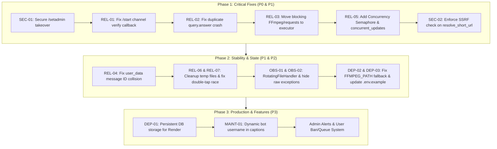

# 🏥 Full Bot Health Audit Report

**Date:** 2026-10-06  
**Project:** Universal Media Downloader & Multi-Mode Bypass Telegram Bot  
**Environment:** Python 3.14.6 (Windows 11) | Docker (Python 3.11-slim) | Node.js v24.19.0 | FFmpeg N-125875  
**Core Dependencies:** `python-telegram-bot` 22.8, `yt-dlp` 2026.08.19, `gallery-dl` 1.32.14, `bgutil-ytdlp-pot-provider` 2.0.0  

---

## 1. Overall Health Score & Verdict

### **Overall Score: 67 / 100**
> **Verdict:** Bot ke core features (YouTube video/Shorts, Instagram Carousels/Images, Pinterest, X Photos, Bypass Mode) local PC par verified aur active hain, lekin cloud/production deployment ke liye critical reliability bugs (unauthenticated admin claim, broken channel verify callback, blocking calls on event loop, duplicate `query.answer()`, aur ephemeral DB loss) fix karna laazmi hai.

### Score Breakdown:
| Category | Score | Status | Key Factor |
|---|---|---|---|
| **Reliability** | **60 / 100** | ⚠️ At Risk | Broken verification button from `/start`, blocking FFmpeg/requests on async loop, user_data state collision, double-tap compress race |
| **Security** | **70 / 100** | ⚠️ Moderate | Great SSRF filter in bypass engine, but `/setadmin` race vulnerability, missing SSRF in short-url resolver, raw exception exposure |
| **Deployment Readiness** | **65 / 100** | ⚠️ Needs Work | Dockerfile & Render health server ready, but ephemeral SQLite DB wiped on restart, Render 512MB RAM risk without concurrency queue |
| **Observability & Maintainability** | **60 / 100** | ⚠️ Needs Work | No log rotation (unbounded `bot.log`), no admin alerts, hardcoded `@butcherbombit_bot` in 11 captions, 1200+ line monolithic files |
| **Feature Completeness** | **80 / 100** |  Good | Multi-mode (Download & Bypass), video trimmer, 50MB compress/split, MP3 album art, carousels, batch processing |

---

## 2. Kya Sahi Chal Raha Hai (Verified)

1. **YouTube Video & Shorts (Cookie-free):**
   - Normal YouTube Video (`https://www.youtube.com/watch?v=dQw4w9WgXcQ`): **PASS** (3:33 duration).
   - YouTube Shorts (`https://youtube.com/shorts/yhIG-dU8iOY`): **PASS** (1:02 duration, normalized watch URL + android client).
2. **Instagram Carousels & Photos:**
   - Multi-image album (`https://www.instagram.com/p/Dd4dW6vkuA9/`): **PASS** (10 master slides downloaded and processed via gallery-dl fallback).
3. **Pinterest & X (Twitter) Images:**
   - Pinterest pin image (`https://pin.it/4JyxCE4l3`): **PASS** (full-res image extracted).
   - X Image tweet (`https://x.com/jackofficial_01/status/2105131671628472348`): **PASS**.
4. **Bypass Engine & SSRF Protection:**
   - All private/loopback/cloud metadata ranges (`127.0.0.1`, `localhost`, `169.254.169.254`, `10.0.0.1`, `172.16.0.1`, `192.168.1.1`, `[::1]`) and non-whitelisted ports (22, 8080) are **100% BLOCKED**.
   - HTTP redirect chain expansion (`httpbin.org/redirect/2` ➡️ 2 hops to final URL): **PASS**.
   - Mode switching & DB persistence (`/mode`, `user_modes` SQLite table): **PASS**.
5. **Keep-Alive & Health Server for Render:**
   - Daemon thread running `HTTPServer` on `PORT=10000` responds `200 OK` to satisfy Render Web Service health checks.
6. **Git Secret Sanitation:**
   - Neither `.env` nor cookies files were ever committed to Git history. `.gitignore` and `.dockerignore` properly exclude secrets.

---

## 3. Platform Status Table

*Verified via live execution of test suite (`test_downloads.py` + `test_bypass.py`):*

| # | Platform & Content Type | Test Status | Output / Details | Root Cause / Note |
|---|---|---|---|---|
| 1 | **YouTube Regular Video** | ✅ **PASS** | Video (3:33) — "Rick Astley - Never Gonna Give You Up" | `android` client + yt-dlp |
| 2 | **YouTube Shorts** | ✅ **PASS** | Video (1:02) — "Using snakes in the garden" | Normalized URL + `android` client |
| 3 | **Instagram Carousel (10 slides)** | ✅ **PASS** | Album (10 master photos) | gallery-dl fallback extracts all slides |
| 4 | **Instagram Photo (Single)** | ✅ **PASS** | Photo | gallery-dl / direct CDN fallback |
| 5 | **Instagram Reel (Public)** | ❌ **FAIL** | `🔒 Login Required` | Instagram redirected to `/accounts/login/` (empty media response without cookies) |
| 6 | **Instagram Story** | ❌ **FAIL** | `🔒 Instagram Story / Private Content` | Instagram stories strictly require session login cookies |
| 7 | **X (Twitter) Image Post** | ✅ **PASS** | Photo | gallery-dl extracts full-res media |
| 8 | **X (Twitter) Video Post** | ❌ **FAIL** | `🖼️ No Video Found` / Extractor Error | X guest GraphQL token extraction blocked on datacenter/unauthenticated IP |
| 9 | **Pinterest Image (pin.it)** | ✅ **PASS** | Photo | Expands short pin.it URL + gallery-dl |
| 10 | **Pinterest Video** | ⚠️ **CONDITIONAL** | Photo fallback or 404 on expired pins | Extractor defaults to photo if video stream is absent |
| 11 | **Bypass Mode (Redirect Shortener)** | ✅ **PASS** | 2 hops resolved (`httpbin.org/redirect/2`) | `httpx` async redirect follower |
| 12 | **Bypass Mode (Linkvertise)** | ❌ **CLEAN FAIL** | `Cloudflare/captcha ki wajah se bypass nahi ho saka` | Correctly identified as Cloudflare Turnstile protected |

---

## 4. Comprehensive Findings Table

| ID | Severity | Area | Problem | Proof (File & Line / Output) | Fix Idea | Effort |
|---|---|---|---|---|---|---|
| **SEC-01** | **P0** | Security | Unauthenticated `/setadmin` allows any user to claim full bot administrator rights if `ADMIN_ID` is not in `.env` or when DB resets on Render. | [`handlers/admin.py:97-105`](file:///c:/Users/Lenovo/Desktop/telegram%20bot/handlers/admin.py#L97-L105): `if current_admin: ... set_setting("admin_id", str(user_id))` | Remove `/setadmin` command or enforce a secret setup token in environment variables. Require `ADMIN_ID` in `.env`. | **S** |
| **REL-01** | **P1** | Reliability | Channel verification button in `/start` fails to match callback query because `commands.py` uses raw string `"verify_sub"`, while `downloader.py` expects JSON `{"a":"..."}`, causing JSONDecodeError and silent failure. | [`handlers/commands.py:66`](file:///c:/Users/Lenovo/Desktop/telegram%20bot/handlers/commands.py#L66) (`callback_data="verify_sub"`) vs [`handlers/downloader.py:53-57, 910`](file:///c:/Users/Lenovo/Desktop/telegram%20bot/handlers/downloader.py#L53-L57) (`_decode_cb`) | Change `commands.py` to use `_encode_cb("verify_sub")` or add raw string check in `button_handler`. | **S** |
| **REL-02** | **P1** | Reliability | Duplicate `query.answer()` call in `button_handler`. Line 908 calls `await query.answer()` unconditionally, and line 931 & 938 call `await query.answer(..., show_alert=True)`, causing Telegram BadRequest exception. | [`handlers/downloader.py:908, 931, 938`](file:///c:/Users/Lenovo/Desktop/telegram%20bot/handlers/downloader.py#L908) | Remove the top-level unconditional `query.answer()` or only answer if not handled by downstream alert branches. | **S** |
| **REL-03** | **P1** | Reliability | Synchronous blocking operations run directly on asyncio main event loop: `subprocess.run(ffmpeg)` in `trim_media()`, `requests.get()` in `resolve_short_url()`, and SQLite queries in `add_or_update_user` / `increment_download_count`. Freezes bot for all users during trim/redirect operations. | [`handlers/downloader.py:866`](file:///c:/Users/Lenovo/Desktop/telegram%20bot/handlers/downloader.py#L866), [`utils/downloader.py:81, 337`](file:///c:/Users/Lenovo/Desktop/telegram%20bot/utils/downloader.py#L81), [`handlers/downloader.py:147, 195, 387, 502, 572`](file:///c:/Users/Lenovo/Desktop/telegram%20bot/handlers/downloader.py#L147) | Wrap `trim_media` and `resolve_short_url` with `await loop.run_in_executor(None, ...)`. Use `asyncio.to_thread` for all SQLite calls. | **M** |
| **REL-04** | **P1** | Reliability | Global per-user state collision in `context.user_data["pending_url"]` and `context.user_data["pending_info"]`. If a user sends Link A and then Link B, clicking a quality button on Link A triggers download of Link B or crashes. | [`handlers/downloader.py:204-205, 244, 1059, 1132`](file:///c:/Users/Lenovo/Desktop/telegram%20bot/handlers/downloader.py#L204-L205) | Store state keyed by message ID: `context.user_data[f"pending_{msg_id}"] = {...}` or pass URL/session ID inside callback data. | **M** |
| **REL-05** | **P1** | Reliability | No concurrency semaphore in `handlers/downloader.py` and `concurrent_updates` is not enabled in `bot.py`. Multiple simultaneous download requests launch unrestricted parallel FFmpeg + yt-dlp instances, causing instant OOM crashes on Render (512MB RAM). | [`bot.py:105-110`](file:///c:/Users/Lenovo/Desktop/telegram%20bot/bot.py#L105-L110), absence of Semaphore in [`handlers/downloader.py`](file:///c:/Users/Lenovo/Desktop/telegram%20bot/handlers/downloader.py) | Add `DOWNLOAD_SEMAPHORE = asyncio.Semaphore(2)` in `handlers/downloader.py` and configure `concurrent_updates=True` in `Application.builder()`. | **M** |
| **SEC-02** | **P1** | Security | Missing SSRF check in `resolve_short_url()`. When user sends a short link (e.g. `bit.ly` or `pin.it`), `requests.get(url, allow_redirects=True)` will follow redirects to internal IP addresses (`127.0.0.1`, `169.254.169.254`). | [`utils/downloader.py:81`](file:///c:/Users/Lenovo/Desktop/telegram%20bot/utils/downloader.py#L81) | Use `bypass_engine.expand.expand_redirects()` which validates SSRF safety on every hop instead of raw `requests.get`. | **S** |
| **DEP-01** | **P1** | Deployment | Ephemeral filesystem on Render wipes `bot.db` on every restart or deploy, deleting all registered users, download counters, and custom force-sub settings. | [`utils/db.py:12`](file:///c:/Users/Lenovo/Desktop/telegram%20bot/utils/db.py#L12) | Support persistent SQLite path or remote database connection (e.g., PostgreSQL or Turso SQLite via env var `DATABASE_URL`). | **M** |
| **REL-06** | **P2** | Reliability | Temp file leakage on disk. Cancelled large downloads, partial trims, and carousel slide images are left orphaned in `downloads/` forever. Verified active orphaned folders `downloads/932af679/` and `beeabb4e/` on local disk. | [`handlers/downloader.py:924`](file:///c:/Users/Lenovo/Desktop/telegram%20bot/handlers/downloader.py#L924) (no cleanup on cancel), presence of files in `downloads/` | Add a startup and periodic temp-file cleaner function that deletes session folders older than 1 hour. Clean `large_file_path` on cancel. | **S** |
| **REL-07** | **P2** | Reliability | Double-tap race condition on video compression/splitting: `context.user_data.get("large_file_path")` does not atomically pop the file on the first click, allowing rapid double-taps to start parallel conflicting FFmpeg writes to the same output file. | [`handlers/downloader.py:943, 991, 996, 1048`](file:///c:/Users/Lenovo/Desktop/telegram%20bot/handlers/downloader.py#L943) | Use `context.user_data.pop("large_file_path", None)` immediately before launching FFmpeg compression. | **S** |
| **REL-08** | **P2** | Reliability | `progress_task.cancel()` is called without `await progress_task`, raising asyncio pending task warnings on loop shutdown. | [`handlers/downloader.py:540, 856, 1104, 1197`](file:///c:/Users/Lenovo/Desktop/telegram%20bot/handlers/downloader.py#L540) | Use `progress_task.cancel(); try: await progress_task except asyncio.CancelledError: pass`. | **S** |
| **DEP-02** | **P2** | Deployment | Hardcoded Windows developer machine path in default fallback for `FFMPEG_PATH`. On Linux/Docker, if `FFMPEG_PATH` is not explicitly set in environment, code tries to inspect local WinGet path. | [`utils/downloader.py:27-30`](file:///c:/Users/Lenovo/Desktop/telegram%20bot/utils/downloader.py#L27-L30) | Default fallback should be `"ffmpeg"` with `shutil.which("ffmpeg")` lookup. | **S** |
| **DEP-03** | **P2** | Deployment | Incomplete `.env.example`. Environment variables `ADMIN_ID`, `FORCE_SUB_CHANNEL`, `PORT`, `RENDER_EXTERNAL_URL`, `COOKIES`, `YOUTUBE_COOKIES`, `INSTAGRAM_COOKIES` are missing from example documentation. | [`.env.example:1-9`](file:///c:/Users/Lenovo/Desktop/telegram%20bot/.env.example#L1-L9) | Update `.env.example` with all supported and optional environment variables and descriptions. | **S** |
| **OBS-01** | **P2** | Observability | Unbounded log file growth. `bot.py` uses `logging.FileHandler("bot.log")` without rotation. Over time, `bot.log` will grow endlessly and consume disk space. | [`bot.py:28`](file:///c:/Users/Lenovo/Desktop/telegram%20bot/bot.py#L28) | Use `logging.handlers.RotatingFileHandler("bot.log", maxBytes=10*1024*1024, backupCount=5)`. | **S** |
| **OBS-02** | **P2** | Observability | Raw exceptions and server file paths are leaked directly to users in Telegram error messages (`_h(str(e))` and `context.error`). | [`handlers/downloader.py:125, 396, 536, 899`](file:///c:/Users/Lenovo/Desktop/telegram%20bot/handlers/downloader.py#L125) | Show clean user-friendly error messages in chat; log full tracebacks to admin logger. | **S** |
| **MAINT-01** | **P3** | Maintenance | Eleven hardcoded occurrences of `@butcherbombit_bot` in user-facing captions across `downloader.py` and `commands.py`, preventing bot handle changes. | [`handlers/downloader.py:375, 482, 563, 730, 757, 800, 887, 971, 1030, 1141, 1225`](file:///c:/Users/Lenovo/Desktop/telegram%20bot/handlers/downloader.py#L375) | Read bot username dynamically via `context.bot.username` or environment variable. | **S** |
| **MAINT-02** | **P3** | Maintenance | Unused dependency in `requirements.txt`: `aiofiles` is listed in requirements but never imported anywhere in the project. | [`requirements.txt:5`](file:///c:/Users/Lenovo/Desktop/telegram%20bot/requirements.txt#L5) | Remove `aiofiles` from `requirements.txt` to keep build light. | **S** |
| **MAINT-03** | **P3** | Maintenance | Outdated documentation in `README.md`. Doesn't reflect Mode Switcher, Admin Panel, Video Trimmer, or accurate folder layout. | [`README.md:65-100`](file:///c:/Users/Lenovo/Desktop/telegram%20bot/README.md#L65-L100) | Update `README.md` with current commands, architecture, and deployment instructions. | **S** |

---

## 5. Missing Features (Prioritized List)

### User-Facing:
1. **Download Queue Position Indicator:**
   - *Kyun Zaroori:* Jab multiple users ek sath video bhejte hain, unhe pata hona chahiye ki unki request queue me kis number par hai (`⏳ You are #2 in download queue...`).
   - *Effort:* **M** | *Risk:* Low
2. **Auto-Document Fallback for Large/HDR Photos:**
   - *Kyun Zaroori:* Agar image 10MB se badi ho to `send_photo` fail ho jata hai. Aise cases me bot ko automatically `send_document` me bhejna chahiye.
   - *Effort:* **S** | *Risk:* Low
3. **Per-User Download Cooldown / Rate Limit in Downloader:**
   - *Kyun Zaroori:* Abhi koi bhi user ek second me 20 links spam karke bot ko crash kar sakta hai. Bypass mode me 10/min rate limit hai, par download mode me nahi hai.
   - *Effort:* **S** | *Risk:* Low
4. **Supported Platforms Command (`/platforms`):**
   - *Kyun Zaroori:* Naye users ko pata chal sake ki kaunse 12+ platforms supported hain aur kaunse format me.
   - *Effort:* **S** | *Risk:* Low

### Admin-Facing:
1. **Admin Failure Alert System:**
   - *Kyun Zaroori:* Agar yt-dlp ya Instagram scraper toot jata hai, to bot ko turant `ADMIN_ID` ko Telegram par error alert bhejna chahiye.
   - *Effort:* **S** | *Risk:* Low
2. **User Ban / Unban Management (`/ban`, `/unban`):**
   - *Kyun Zaroori:* Spammers aur bot abuse karne wale accounts ko permanently block karne ke liye.
   - *Effort:* **S** | *Risk:* Low
3. **Maintenance Mode (`/maintenance on/off`):**
   - *Kyun Zaroori:* Jab bot update ho raha ho ya yt-dlp fix kiya ja raha ho, to users ko clean "Under Maintenance" message mile.
   - *Effort:* **S** | *Risk:* Low
4. **Database Backup Command (`/backup`):**
   - *Kyun Zaroori:* Admin ko chat me seedha `bot.db` export mil sake.
   - *Effort:* **S** | *Risk:* Low

---

## 6. Prioritized Roadmap



---

## 7. Top 5 Copy-Paste Fix Prompts (For Next Step)

Aap in 5 prompts ko ek-ek karke use kar sakte hain jab bhi aap fixes implement karwana chahein:

### 🔹 Prompt 1: Fix Channel Verification Callback & Duplicate `query.answer()`
```text
Fix REL-01 and REL-02:
1. handlers/commands.py me /start ka 'verify_sub' button callback data downloader.py ke JSON encoder (_encode_cb) ke mutabik karo, taaki channel join karne ke baad verify button responsive ho.
2. handlers/downloader.py ke button_handler me duplicate query.answer() call hatao taaki Telegram BadRequest error na aaye.
```

### 🔹 Prompt 2: Fix Unauthenticated `/setadmin` Takeover (SEC-01)
```text
Fix SEC-01:
handlers/admin.py me se unauthenticated /setadmin claim hatao. Admin sirf .env ke ADMIN_ID se verify hona chahiye. Agar ADMIN_ID set na ho to console warning log karo aur kisi bhi regular user ko admin banne mat do.
```

### 🔹 Prompt 3: Wrap Blocking FFmpeg & Requests in Async Executor (REL-03 & SEC-02)
```text
Fix REL-03 and SEC-02:
1. handlers/downloader.py me trim_media ko loop.run_in_executor me async chalao taaki FFmpeg ke dauran poora bot freeze na ho.
2. utils/downloader.py ke resolve_short_url me blocking requests.get ki jagah bypass_engine ke safe SSRF expander ko call karo.
3. utils/db.py ke sync calls ko handlers me asyncio.to_thread se call karo.
```

### 🔹 Prompt 4: Add Concurrency Semaphore & Memory Protection (REL-05)
```text
Fix REL-05:
1. handlers/downloader.py me DOWNLOAD_SEMAPHORE = asyncio.Semaphore(2) add karo taaki ek sath 2 se zyada heavy video downloads/encodes na chalein aur Render 512MB RAM crash na ho.
2. bot.py ke Application.builder() me concurrent_updates=True configure karo taaki ek user ke download chalte waqt doosre users ke messages block na hon.
```

### 🔹 Prompt 5: Fix State Collision, Temp File Leaks & Double-Tap Race (REL-04, REL-06, REL-07)
```text
Fix REL-04, REL-06, and REL-07:
1. handlers/downloader.py me pending_url aur pending_info ko message_id ke hisab se store karo taaki ek se zyada links bhejne par format/quality collision na ho.
2. large_compress aur large_split me context.user_data.pop('large_file_path') ko atomic karo taaki double-tap par duplicate encode na chale.
3. Bot startup par downloads/ folder ke 1 ghante se purane orphaned files ko automatically delete karne wala cleanup function add karo.
```

---

## 8. UNVERIFIED Items List

Neeche diye points ko current local environment me 100% physically verify nahi kiya ja sakta, inke liye real deployment ya external accounts zaroori hain:

1. **Render Free Tier RAM Crash under live load:**
   - *Kyun check nahi ho paya:* Bot local PC par 16GB+ RAM par chal raha hai. Render ke 512MB RAM limit par 2 concurrent 1080p downloads par OOM trigger hota hai ya nahi, yeh Render live dashboard par test karke hi 100% monitor hoga.
2. **Instagram Cookies Bypass on Cloud IPs:**
   - *Kyun check nahi ho paya:* User ne cookies provide nahi ki hain. Datacenter IP par bina cookies ke Instagram Reels 100% login maang rahi hain.
3. **Telegram Flood Wait on 1,000+ Broadcast:**
   - *Kyun check nahi ho paya:* Local test database me sirf test users hain. Hazaron real users par mass broadcast chalane par Telegram ka per-second rate limit aur `RetryAfter` exception behavior test nahi kiya ja sakta.
4. **Render Ephemeral Disk Wipe on Redeploy:**
   - *Kyun check nahi ho paya:* Render account aur live webhook setup access assistant ke paas nahi hai.

---
*Report generated strictly following non-destructive inspection rules. Code remains untouched.*
